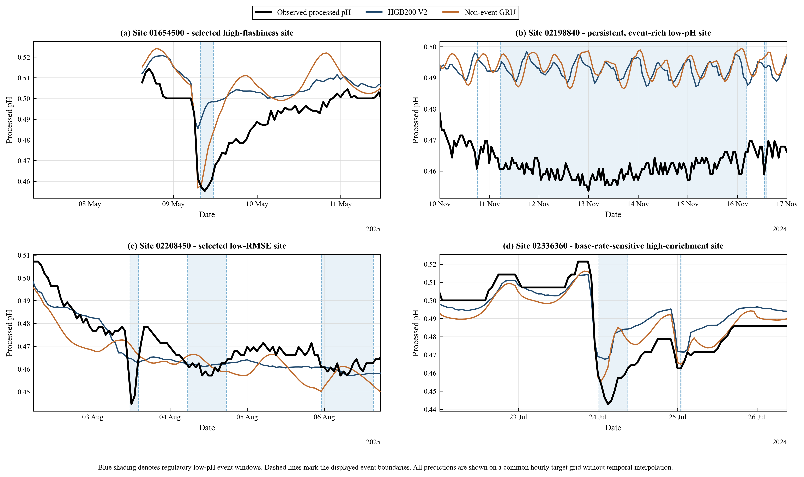
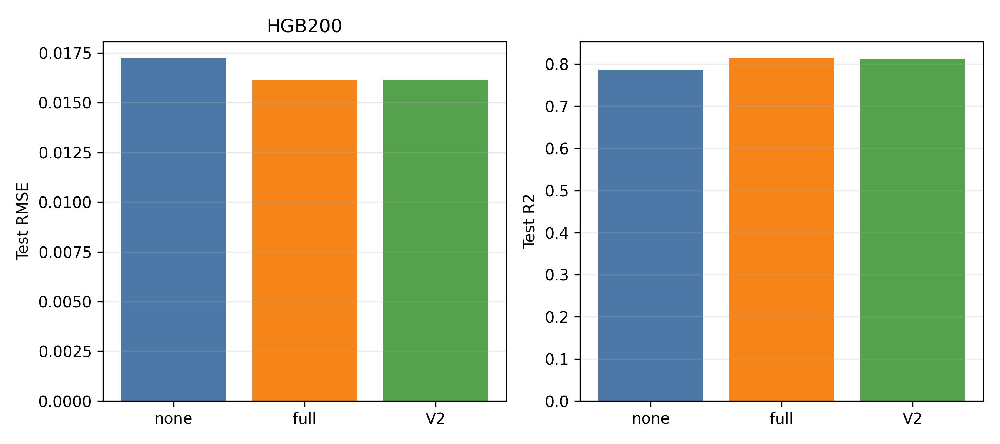
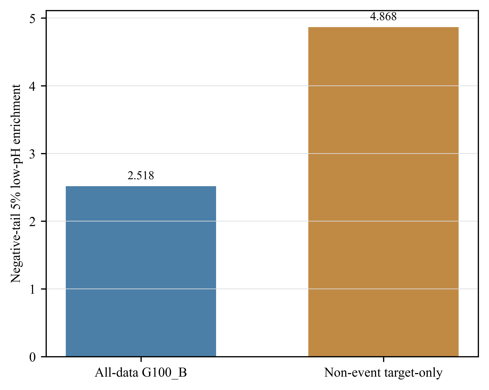
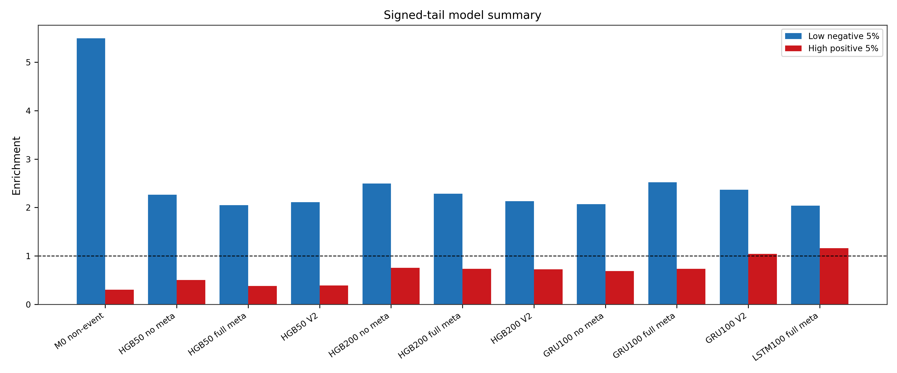

# pH Hot-Moment Modelling

Code-only repository for multi-site prediction-based detection of pH hot
moments from high-frequency water-quality sensor data and hydrological
metadata.

The primary models predict processed pH (`00400`) from exogenous variables:

- water temperature (`00010`)
- specific conductance (`00095`)
- turbidity (`63680`)
- discharge (`00060`)
- gage height (`00065`)
- calendar and cyclical time features

Historical pH and regulatory event labels are deliberately excluded from the
main predictors. Regulatory low/high pH windows are incomplete weak labels used
for residual-tail evaluation and controlled non-event training only.

## Results preview

The figures below are selected previews from the completed analyses. Values are
in processed pH space; they must not be interpreted directly as native pH units.

### Contrasting monitored sites

Observed processed pH is shown against the HGB200 V2 and non-event GRU
predictions. Blue shading marks regulatory low-pH weak-label windows. The four
sites illustrate substantial differences in event persistence, flashiness and
model fit.



### Hydrological metadata and prediction

For the strict 200-site HGB experiment, adding the full metadata set reduced
test RMSE from `0.017215` to `0.016119` and increased test R-squared from
`0.7869` to `0.8132`. Compact V2 metadata retained almost all of this prediction
benefit (`RMSE = 0.016159`, `R-squared = 0.8123`) with a smaller and more
interpretable feature set.



### Controlled non-event GRU training

Excluding weak-label event target rows from GRU training improved test RMSE
from `0.017130` to `0.016741` and increased low-pH enrichment in the negative
5% residual tail from `2.52` to `4.87`.

<p align="center">
  
</p>

### Direction-specific residual behaviour

Low-pH events were consistently enriched in negative residual tails, whereas
high-pH positive-tail enrichment was weaker and model-dependent. This
asymmetry is a substantive result rather than evidence that every large
residual is an environmental event.



These event windows are incomplete regulatory weak labels. Prediction accuracy
and event-tail enrichment are reported as separate outcome families.

## Start here

On a new computer, give Codex
[the other-device start file](documentation/START_HERE_OTHER_DEVICE.md) first.
It instructs Codex to inspect the machine and data and recommend the next valid
step before any heavy processing.

Read [the cross-device execution plan](documentation/ph_cross_device_full_pipeline_plan_v1.md)
before running the scripts. It defines the cohort rules, leakage controls,
chronological splits, metadata construction, HGB and sequence experiments,
signed residual analysis, and acceptance checks.

## Repository layout

```text
pipeline/                Ten curated stages in execution order
config/                  Compact V2 metadata definition
documentation/           Full cross-device execution and validation plan
analysis_outputs/        Generated locally when scripts run; never versioned
```

Only the latest scripts that contributed to the current modelling conclusions
are included. Superseded development versions, duplicated reruns, 50-site
prototype scripts, report generators, and figure-only utilities are excluded.
See [the pipeline index](pipeline/README.md) for the purpose and dependencies of
each retained stage.

## Local data layout

Data and model artefacts are intentionally not included. On a working machine,
provide at least:

```text
data/processed/
data/reference/sites_register.json
data/reference/regulatory_events.csv
```

Install dependencies in an isolated environment:

```powershell
py -3.12 -m venv .venv
.\.venv\Scripts\Activate.ps1
python -m pip install -r requirements.txt
```

Run the lightweight inventory and cohort audit before any heavy model training.
The present data supported approximately 201 sites with the exact common
predictor schema, so the directly comparable primary experiment uses a strict
200-site cohort. Any larger alias-normalised or reduced-predictor cohort must be
reported separately.

## Data policy

This private repository contains source code and documentation only. It does
not contain raw/processed observations, registry records, event CSV files,
predictions, model weights, figures, Word/PDF reports, or environment secrets.
